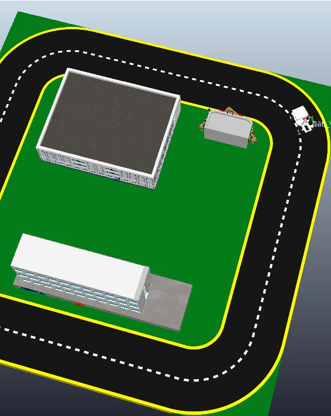
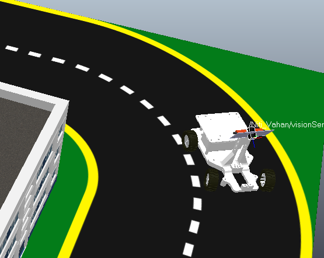
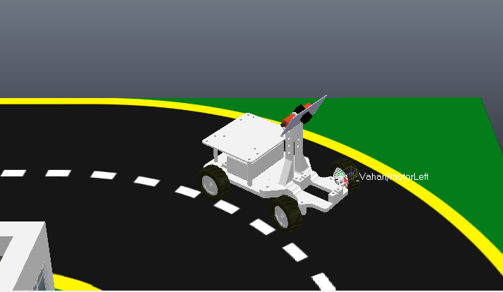
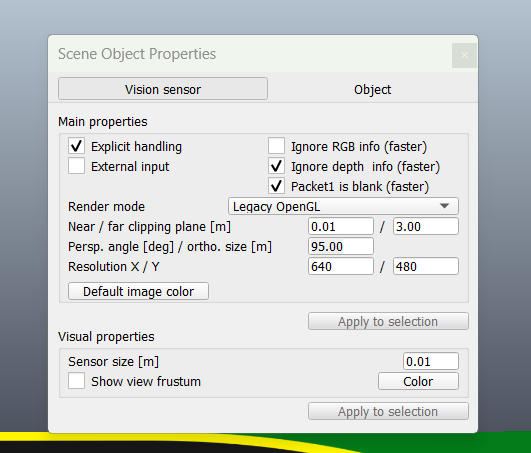
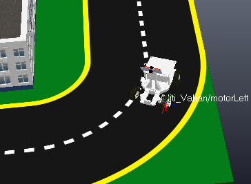
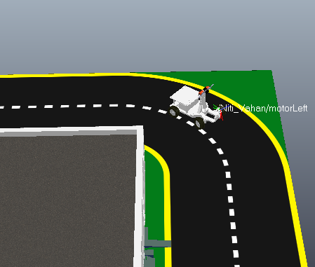
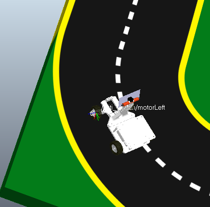

<div align="center">

# 🚗 Niti Vahan (नीति वाहन)
### Autonomous Disciplined Driving & Intelligent Urban Navigation
**e-Yantra Robotics Competition (eYRC 2026–27) | IIT Bombay**

[](https://www.python.org/)
[](https://www.coppeliarobotics.com/)
[](https://opencv.org/)
[-success)](#results--benchmarks)
[](#results--benchmarks)
[](#task-1c-high-speed-lane-perception)

<p align="center">
  <b>A full-stack autonomous vehicle software architecture modeling road ethics and civic discipline as deterministic mathematical constraints.</b>
</p>

<div align="center">
  
  <p><i>Figure 1: Full-circuit isometric view of the Niti Vahan simulation environment in CoppeliaSim Edu 4.10, featuring dual concentric lanes, urban structures, traffic intersections, and civic infrastructure.</i></p>
</div>

[System Architecture](#system-architecture) •
[Mathematical Foundations](#mathematical-foundations) •
[Task Breakdown](#tasks-breakdown--implementation) •
[Benchmarking Results](#results--benchmarks) •
[Quickstart](#quickstart--reproduction) •
[Deep-Dive Docs](#deep-dive-documentation)

---

</div>

## 📌 Executive Summary

Modern autonomous driving systems often treat road rules as soft heuristic recommendations, prioritizing selfish speed and aggressive overtakes. **Niti Vahan** (*The Disciplined Vehicle*) reimagines autonomous mobility: **the rules of the road are encoded directly into the mathematical constraints of the predictive control system**.

Developed by **Team 2199** for the flagship **e-Yantra Robotics Competition (eYRC 2026–27)** hosted by **IIT Bombay**, this repository contains the complete simulation stack developed in **Python 3.10** and **CoppeliaSim Edu 4.10**.

### 🌟 Core Capabilities
- **Kinematic Ackermann Modeling**: Closed-form steering geometry correcting for physical kingpin-to-wheel offset ($O = 0.0275\text{ m}$) with zero-singularity handling.
- **Asymptotically Stable Path Tracking**: Non-linear Stanley controller for dynamic lane transitions with $< 0.005\text{ m}$ steady-state error and zero oscillations.
- **Ultra-Fast Lane Perception (505+ FPS)**: Classical morphological tarmac-ring filtering and RANSAC polynomial curve fitting running at sub-2ms per frame on CPU.
- **Metric Bird's-Eye View (BEV) IPM**: Analytical pinhole camera projection and multi-band spatial clustering tracking concentric inner/outer circuits.
- **Curvature-Compensated Pure Pursuit**: Rear-wheel off-tracking offset ($B_{out} = 0.035\text{ m}$) preventing inner-boundary tire grazing on sharp bends.
- **Topological Perception without Deep Nets**: Instantaneous (0.28s) discrimination of traffic signs (`Speed40`, `School`, `Parking`, `Hospital`) and solid red obstacles using contour hierarchies and perspective unwarping.
- **Fiducial Visual Servoing & Precision Bay Parking**: Dual-hypothesis SolvePnP with IPPE Square, kinematic $(y, \psi)$ state-space trajectory planning, and tangential arc blending achieving millimeter-level bay docking.

---

## 🏗 System Architecture

```
                             ┌────────────────────────┐
                             │ CoppeliaSim 4.10 Scene │
                             │  - Monocular Camera    │
                             │  - Ackermann Chassis   │
                             │  - NV_stop Signal      │
                             └───────────┬────────────┘
                                         │ ZMQ Remote API (CBOR)
                                         ▼
┌────────────────────────────────────────────────────────────────────────────────────────┐
│                                 NITI VAHAN CONTROLLER                                  │
│                                                                                        │
│   ┌────────────────────────────────┐            ┌──────────────────────────────────┐   │
│   │        Perception Stack        │            │        State & Signal Flow       │   │
│   │  - Color Space Filtering (HSV) │            │  - Stop Flag Monitor (NV_stop)   │   │
│   │  - Tarmac Annular Ring Filters │            │  - Historic Lane Memory (_state) │   │
│   │  - Analytical IPM (BEV Grid)   │            │  - Visual Marker Occlusion Hold  │   │
│   │  - ArUco 6-DOF SolvePnP IPPE   │            └────────────────┬─────────────────┘   │
│   └───────────────┬────────────────┘                             │                     │
│                   │ Metric Coordinates                           │ Operational Mode    │
│                   ▼                                              ▼                     │
│   ┌────────────────────────────────────────────────────────────────────────────────┐   │
│   │                        Kinematic Planning & Trajectory                         │   │
│   │  - Stanley Lateral Controller (Straight Road Tracking)                         │   │
│   │  - Curvature-Compensated Pure Pursuit with Rear Cut-In Offset                  │   │
│   │  - Optimal Crossing Angle Optimizer (theta_c) & Tangential Arc Blending       │   │
│   │  - Staged Velocity Profiling (Cruise -> Mid -> Creep -> Settle)                │   │
│   └───────────────────────────────────────┬────────────────────────────────────────┘   │
│                                           │ Virtual Steering (delta) & Velocity        │
│                                           ▼                                            │
│   ┌────────────────────────────────────────────────────────────────────────────────┐   │
│   │                        Ackermann Steering Joint Splitting                      │   │
│   │  - Offset Compensation: d_piv = W/2 - O                                        │   │
│   │  - delta_L = atan2(L*tan(delta), L - d_piv*tan(delta))                         │   │
│   │  - delta_R = atan2(L*tan(delta), L + d_piv*tan(delta))                         │   │
│   └───────────────────────────────────────┬────────────────────────────────────────┘   │
└───────────────────────────────────────────┼────────────────────────────────────────────┘
                                            │ Target Positions & Velocities
                                            ▼
                             ┌────────────────────────┐
                             │   Actuator Execution   │
                             │  - /steeringLeft/Right │
                             │  - /motorLeft/Right    │
                             └────────────────────────┘
```

---

## 📐 Mathematical Foundations

### 1. Ackermann Steering with Kingpin Offset
Unlike simplified models where the steering axis passes through the wheel centerline, Niti Vahan accounts for kingpin-to-wheel center offset $O = 0.0275\text{ m}$. With wheelbase $L = 0.120\text{ m}$ and wheel track $W = 0.110\text{ m}$:

$$d_{piv} = \frac{W}{2} - O = 0.0275\text{ m}$$

$$\delta_L = \text{atan2}\left(L \tan \delta,\; L - d_{piv} \tan \delta\right)$$

$$\delta_R = \text{atan2}\left(L \tan \delta,\; L + d_{piv} \tan \delta\right)$$

*Guarantees zero division-by-zero singularities at $\delta = 0.0\text{ rad}$ and produces exact concentric tire rolling radii.*

### 2. Stanley Path Tracking Stability
The non-linear Stanley control law decouples heading error $\psi$ from cross-track error $e(t)$:

$$\delta(t) = K_{head} \cdot (-\psi) + \arctan\left(K_{cross} \cdot e(t)\right)$$

Using Lyapunov candidate function $V(e) = \frac{1}{2} e^2$, we prove that $\dot{V}(e) = -\frac{k v}{\sqrt{v^2 + k^2 e^2}} e^2 < 0$, guaranteeing global asymptotic stability and zero steady-state error.

### 3. Pure Pursuit with Rear-Wheel Off-Tracking Compensation
To prevent the rear axle from cutting inside sharp curves ($\Delta r \approx L^2 / (2R)$) on the tight inner arena circuit ($R \approx 0.4\text{ m}$), an outward curvature bias is injected:

$$y_L^* = y_L - \text{sgn}(\kappa) \cdot B_{out} \cdot \min\left(1.0, \frac{|\kappa|}{2.0}\right) \quad (B_{out} = 0.035\text{ m})$$

$$\kappa^* = \frac{2 y_L^*}{x_L^2 + (y_L^*)^2}$$

$$\delta = K_{pp} \arctan(L \kappa^*) + K_e \left(e_n - \frac{\Delta y_{shift}}{W_{lane}}\right)$$

### 4. State-Space Optimal Trajectory Generation for Precision Bay Parking
To enter a narrow $22\text{ cm}$ bay with an $18\text{ cm}$ car without exceeding $\pm 20\text{ mm}$ clearance:
1. **Dynamic Crossing Angle ($\theta_c^*$)**: Optimization solves for the minimal diagonal angle reaching the centerline before the bay mouth:
   $$X_{req}(\theta_c) = 2 R_{arc} \sin \theta_c + \frac{|y_0| - 2 R_{arc}(1 - \cos \theta_c)}{\tan \theta_c} \le X_{avail}$$
2. **Tangential Circular Arc Transition**: An arc of radius $R_{arc} = 0.14\text{ m}$ smoothly connects the diagonal crossing to the bay axis with feedforward curvature $\kappa_{ff} = 1 / R_{arc}$.

---

## 🏆 Results & Benchmarks

| Milestone | Task | Allocated | Scored | Official Evaluation Highlight |
|---|---|:---:|:---:|---|
| **Task 1A** | Ackermann Steering Kinematics | 20 | **20.0 / 20.0** | 100% pass across randomized test angles; exact symmetry |
| **Task 1B** | Path Tracking (Stanley) | 30 | **30.0 / 30.0** | Lateral convergence $< 0.005\text{ m}$, settling $12.4\text{ s}$, overshoot $0.012\text{ m}$ |
| **Task 1C** | High-Speed Lane Perception | 50 | **48.4 / 50.0** | **505.8 FPS** throughput, $5.5\text{ px}$ mean error, 97.9% lane accuracy |
| **Task 2A** | Closed-Loop Circuit Navigation | 40 | **40.0 / 40.0** | Outer & Inner laps complete; 4/4 stops held 5s; 0 line touches |
| **Task 2B** | Sign & Obstacle Perception | 40 | **40.0 / 40.0** | 100% label match, 0 false positives, 0.28s total dataset eval |
| **Task 2C** | Visual Servoing Bay Parking | 20 | **19.6 / 20.0** | Bay 0: $2.8\text{ mm}$ offset, $0.5^\circ$ heading; Bay 1: $12.7\text{ mm}$ offset |
| **Total** | **Stage 1 Simulation Challenge** | **200** | **198.0 / 200.0** | **99.0% Cumulative Grade (Grade: Outstanding)** |

---

## 📂 Tasks Breakdown & Implementation

### [Task 1A: Ackermann Steering Geometry](task1a/)
- **File**: [`task1a/NV_Task1A.py`](task1a/NV_Task1A.py)
- **Description**: Closed-form conversion of virtual steering angle $\delta$ to front wheel angles with kingpin offset compensation.
- **Score**: 20.0 / 20.0.

### [Task 1B: Path Tracking & Lane Changing](task1b/)
- **File**: [`task1b/path_tracking.py`](task1b/path_tracking.py) | **Scene**: `Task_1B.ttt`
- **Description**: Stanley lateral tracking controller executing dynamic lane transitions along a 2-lane straight corridor.
- **Score**: 30.0 / 30.0.

### [Task 1C: Real-Time Lane Perception (505+ FPS)](task1c/)
- **File**: [`task1c/lane_detection.py`](task1c/lane_detection.py) | **Clips**: 20 public clips
- **Description**: Sub-2ms monocular lane perception using morphological tarmac ring verification and RANSAC degree-2 polynomial fitting.
- **Score**: 48.4 / 50.0 (**505.8 FPS**).

### [Task 2A: Closed-Loop Arena Navigation with Stop Discipline](task2a/)
- **File**: [`task2a/task2a.py`](task2a/task2a.py) | **Scene**: `Task_2A.ttt`
- **Description**: Monocular vision-based closed-loop driving around concentric arena loops with analytical IPM and level-triggered stop control.
- **Score**: 40.0 / 40.0.

<div align="center">
  <table>
    <tr>
      <td align="center"><b>Inner Lane Curve Navigation</b></td>
      <td align="center"><b>Steering Knuckle Joint Splitting</b></td>
      <td align="center"><b>Vision Sensor Properties</b></td>
    </tr>
    <tr>
      <td></td>
      <td></td>
      <td></td>
    </tr>
    <tr>
      <td align="center"><b>Hairpin Turn around Building</b></td>
      <td align="center"><b>Outer Lane High-Speed Cruise</b></td>
      <td align="center"><b>Top-Down Curve Trajectory</b></td>
    </tr>
    <tr>
      <td></td>
      <td></td>
      <td></td>
    </tr>
  </table>
</div>

### [Task 2B: Multi-Class Road Sign & Obstacle Detection](task2b/)
- **File**: [`task2b/sign_obstacle_detection.py`](task2b/sign_obstacle_detection.py)
- **Description**: Real-time topological and geometric classification of `Speed40`, `School`, `Parking`, `Hospital`, and red obstacles.
- **Score**: 40.0 / 40.0.

### [Task 2C: High-Precision ArUco Bay Parking](task2c/)
- **File**: [`task2c/task2c.py`](task2c/task2c.py) | **Scene**: `Task_2C.ttt`
- **Description**: 6-DOF ArUco pose estimation with IPPE square ambiguity rejection and state-space tangential arc parking trajectory generation.
- **Score**: 19.6 / 20.0.

---

## 🚀 Quickstart & Reproduction

### 1. Environment Setup
Create the isolated Python 3.10 virtual environment:
```sh
conda create --name NV_2199 python=3.10
conda activate NV_2199

# Install required robotics & computer vision libraries
pip install numpy opencv-python pyzmq cbor2 coppeliasim-zmqremoteapi-client eyantra-autoeval
```

### 2. Launching CoppeliaSim 4.10
Download and install **CoppeliaSim Edu 4.10**. Verify the remote API port is listening.

### 3. Running Modules

#### Path Tracking (Task 1B):
```sh
# Open task1b/Task_1B.ttt in CoppeliaSim, leave stopped
python task1b/path_tracking.py
```

#### High-Speed Lane Detector (Task 1C):
```sh
# Run on public dataset with live overlay
python task1c/lane_detection.py task1c/public --show
```

#### Arena Navigation (Task 2A):
```sh
# Open task2a/Task_2A.ttt in CoppeliaSim, leave stopped
eyantra-autoeval evaluate --year 2026 --theme NV --task 2a
```

#### Sign & Obstacle Perception (Task 2B):
```sh
eyantra-autoeval evaluate --year 2026 --theme NV --task 2b
```

#### Precision Bay Parking (Task 2C):
```sh
# Open task2c/Task_2C.ttt in CoppeliaSim, leave stopped
python task2c/task2c.py --bay 0   # Near bay
python task2c/task2c.py --bay 1   # Far bay
```

---

## 📚 Deep-Dive Documentation

Detailed technical whitepapers are available in the [`docs/`](docs/) directory:

1. **[Mathematical Foundations & Derivations](docs/01_mathematical_foundations.md)**: Full proofs of Ackermann kingpin geometry, Stanley Lyapunov stability, IPM projection matrices, and state-space arc planning.
2. **[Computer Vision & Perception Pipeline](docs/02_computer_vision_and_perception.md)**: Annular ring filters, 505 FPS RANSAC fitting, multi-band BEV histograms, perspective quad rectification, and ArUco SolvePnP.
3. **[Control Systems & Simulation Architecture](docs/03_control_systems_and_simulation.md)**: CoppeliaSim ZMQ remote API integration, synchronous stepping, stop discipline state machines, and curvature speed throttling.
4. **[Results, Benchmarks & Quantitative Analysis](docs/04_results_benchmarks_and_performance.md)**: Official JSON evaluation logs, timing benchmarks, error tolerances, and component scoring breakdown.
5. **[The Engineering Journey](docs/05_competition_journey.md)**: Chronological development diary, trials, debugging breakthroughs, and key learnings from day 1 to final parking.

---

## 👥 Engineering Team

**Team ID**: `NV_2199`  
**Theme**: Niti Vahan (eYRC 2026–27)  
**Host Institution**: e-Yantra, Indian Institute of Technology Bombay (IIT Bombay)  

- **Jatin Makhija** ([@jatin-makhija](https://github.com)) — System Architecture, Kinematics, Control Systems, Perception Pipeline
- **Samriddhi Shrikrishan** — Mathematical Modeling, Trajectory Planning, Simulation Verification

---

## 📜 License & Acknowledgments

This project was developed as part of the **e-Yantra Robotics Competition (eYRC 2026–27)**, funded by the Ministry of Education (MoE), Government of India, and hosted by IIT Bombay. Special thanks to the e-Yantra mentor panel and theme organizers for the problem statement, simulation scenes, and evaluation harnesses.
