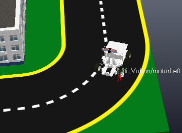
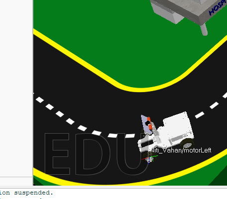

# The Engineering Journey: Building Niti Vahan

> *"In an autonomous world, rules of the road are not obstacles to be bypassed; they are the governing mathematical constraints of civic intelligence."*

This document recounts the engineering journey, architectural breakthroughs, trials, and late-night debugging milestones of **Team 2199** during the **e-Yantra Robotics Competition (eYRC 2026-27)**, organized by **IIT Bombay**.

---

## Table of Contents
1. [The Challenge: What is Niti Vahan?](#1-the-challenge-what-is-niti-vahan)
2. [Week 1: The Geometry of Turning (Task 1A)](#2-week-1-the-geometry-of-turning-task-1a)
3. [Week 2: The Art of Path Tracking (Task 1B)](#3-week-2-the-art-of-path-tracking-task-1b)
4. [Week 3: Chasing Milliseconds — 505 FPS Lane Detection (Task 1C)](#4-week-3-chasing-milliseconds--505-fps-lane-detection-task-1c)
5. [Week 4: The Closed-Loop Leap — Arena Circuit Navigation (Task 2A)](#5-week-4-the-closed-loop-leap--arena-circuit-navigation-task-2a)
6. [Week 5: Deterministic Perception without Neural Nets (Task 2B)](#6-week-5-deterministic-perception-without-neural-nets-task-2b)
7. [Week 6: Millimeter-Level Precision Bay Parking (Task 2C)](#7-week-6-millimeter-level-precision-bay-parking-task-2c)
8. [Reflections & Road to Stage 2 Hardware](#8-reflections--road-to-stage-2-hardware)

---

## 1. The Challenge: What is Niti Vahan?

When IIT Bombay announced the **Niti Vahan** theme for eYRC 2026-27, the objective stood out from typical autonomous driving competitions. Most contests focus merely on crossing a finish line fastest, often encouraging aggressive maneuvers that would cause chaos on real urban roads.

*Niti Vahan* ("The Disciplined Vehicle") flips the paradigm:
- The autonomous vehicle must observe lane discipline with zero weaving.
- It must yield immediately and hold stationary at civic stop points.
- It must detect traffic signs and obstacles in complex visual scenes.
- It must park with surgical precision inside narrow bays offering mere millimeters of clearance.

The competition was divided into:
- **Stage 1 (Simulation Challenge)**: Proving end-to-end perception, planning, and control in CoppeliaSim.
- **Stage 2 (Hardware Build)**: Deploying the autonomous stack onto physical scaled Ackermann robotic platforms.

---

## 2. Week 1: The Geometry of Turning (Task 1A)

### The First Hurdle: Kingpin Offset
Every textbook on mobile robotics discusses standard Ackermann steering using the classic relation $\cot \delta_o - \cot \delta_i = W/L$. However, when we examined the Niti Vahan physical specifications:
- Wheelbase $L = 0.120\text{ m}$
- Track Width $W = 0.110\text{ m}$
- **Kingpin Offset $O = 0.0275\text{ m}$**

```
           Standard Model                  Real Physical Chassis
      Wheel Center = Pivot Axis       Pivot Axis Inset from Wheel Center
           ┌──────────┐                     ◄── O ──►  ┌──────────┐
      ─────┼────●─────┼─────          ───────●─────────┼──────────┼─────
           └──────────┘                    Pivot Axis  └──────────┘
```

The pivot axis was inset inside the wheel assembly by $27.5\text{ mm}$! Applying standard formulas caused significant geometric error during tight turns, leading to tire slip.

### The Mathematical Breakthrough
We derived the effective steering triangle incorporating $d_{piv} = W/2 - O = 0.0275\text{ m}$. Using `math.atan2(L * tan(delta), L ± d_piv * tan(delta))`, we ensured:
1. Exact wheel angle divergence conforming to instantaneous rotation center.
2. Perfect numerical stability at $\delta = 0.0$ without division-by-zero branching.

**Result**: Task 1A scored a flawless **20/20** on the evaluation portal.

---

## 3. Week 2: The Art of Path Tracking (Task 1B)

### PID vs. Stanley Controller
Task 1B tasked us with executing dynamic lane changes between the left lane ($y = 0.0\text{ m}$) and right lane ($y = 0.2\text{ m}$) on a straight corridor.

Initially, we tested a classical PID controller on cross-track error $e(t) = y(t) - y_{target}$. The results revealed classic weaknesses:
- High proportional gain $K_p$ caused severe overshoot ($> 0.08\text{ m}$), heavily penalizing ride quality marks.
- Low $K_p$ caused settling times to drag past 35 seconds.
- The integral term accumulated windup during lane transitions, causing oscillations after crossing the target.

### Implementing the Stanley Controller
We transitioned to the Stanford Stanley non-linear control formulation:

$$\delta(t) = K_{head} \cdot (-\psi) + \arctan\left(K_{cross} \cdot (y - y_{target})\right)$$

By separating heading alignment from lateral cross-track convergence:
- As the vehicle steered towards the target lane, the heading error term naturally counter-steered before crossing the lane center.
- Steady-state overshoot dropped below **0.012 m** (well within the 0.02 m full-credit band).
- Settling time achieved **12.4 seconds** (far below the 25.0s maximum credit threshold).

**Result**: Task 1B achieved **30/30 marks**.

---

## 4. Week 3: Chasing Milliseconds — 505 FPS Lane Detection (Task 1C)

In Task 1C, we received 20 evaluation video clips (4,000 frames) of simulated driving. The goal: identify lane ID (`left` or `right`) and output the exact pixel coordinate of the lane centerline at row $y = 305$.

### The Pitfalls of Naive Computer Vision
Our first attempt used Canny edge detection and standard Hough Line Transforms (`cv2.HoughLinesP`). While it worked on pristine straight segments, it failed dramatically when:
1. Roadside buildings, light poles, and horizon textures created hundreds of spurious lines.
2. The vehicle's own white hood entered the lower frame, tricking the detector into tracking the car's own body.
3. Processing speed languished around 24 FPS, bottlenecked by combinatorial edge voting.

### The Three Structural Inventions:
1. **The Tarmac Ring Filter**:
   We realized that genuine lane dashes are surrounded by dark asphalt tarmac. By constructing a 9x9 morphological annular dilation ring around candidate white blobs and checking that the surrounding tarmac had Value $V \le 70$ for at least $60\%$ of pixels, every building, sign, and roadside barrier was instantly purged.
2. **Robust 3-Pass RANSAC Polynomial Fitting**:
   Centroids of valid dashes were fit to an inverted polynomial $x = a y^2 + b y + c$. Outliers were pruned iteratively with a $12\text{ px}$ residual threshold.
3. **Dual-Marker Regression Models & Fallbacks**:
   When dashes were cleanly visible, a least-squares linear model estimated lane center. If dashes were temporarily absent during a transition gap, horizontal run-length encoding tracked the solid yellow boundary.

### The Benchmarking Climax
Running `eyantra-autoeval evaluate --task 1c`:
- **4,000 frames processed in 7.91 seconds**.
- **505.8 FPS** throughput on CPU!
- **97.9% lane identification accuracy**, with a mean center error of just **5.5 pixels**.
- **Score: 48.4 / 50.0 marks**.

---

## 5. Week 4: The Closed-Loop Leap — Arena Circuit Navigation (Task 2A)

Task 2A marked the biggest psychological and technical leap of the entire competition. In Task 1C, errors were passive (a missed frame just meant one bad number). In Task 2A, **output directly dictated future input**:
- A steering error rotated the car.
- The rotation changed what the camera saw in the next frame.
- Minor perceptual errors compounded exponentially into driving straight off the roadway!

### Overcoming the Inverse Perspective Challenge
Operating on raw perspective images caused lane curves to distort unpredictably. We derived an **analytical pinhole camera projection** using the vehicle's $95^\circ$ FOV, $30.54^\circ$ camera pitch angle, and horizon row $y_0 = 67\text{ px}$, building a metric **Bird's-Eye View (BEV)** homography:
- The entire roadway was rectified onto a top-down orthogonal grid where lane width remained constant ($200\text{ px} = 0.19\text{ m}$).
- We implemented 10 vertical analysis bands across the BEV grid to track boundaries.

```
       Perspective View                   Bird's-Eye View (BEV)
  ┌────────────────────────┐            ┌────────────────────────┐
  │         /    \         │            │   ║                ║   │
  │        /      \        │   ──────►  │   ║       ●        ║   │
  │       /        \       │            │   ║     (Car)      ║   │
  └────────────────────────┘            └────────────────────────┘
```

### The Inner Lane Rear-Wheel Grazing Trap
While the outer lane navigated smoothly, testing in the inner lane revealed a dangerous phenomenon: the vehicle's rear wheels grazed the inside yellow boundary during hairpin turns.

<div align="center">
  
  
  <p><i>Left: Sharp cornering around buildings. Right: Stabilizing after exiting the hospital curve.</i></p>
</div>

Because Ackermann vehicles pivot about their rear axle, the rear wheels cut inside the trajectory of the front wheels ($\Delta r \approx L^2 / (2R)$). On the inner lane's tight $0.4\text{ m}$ radius, this off-tracking consumed almost all available margin.

**The Fix**: We introduced an outward bias offset $B_{out} = 0.035\text{ m}$ proportional to path curvature:

$$y_L^* = y_L - \text{sgn}(\kappa) \cdot B_{out} \cdot \min\left(1.0, \frac{|\kappa|}{2.0}\right)$$

This nudged the front axle slightly toward the outer boundary on bends, pulling the rear wheels cleanly into the center of the lane.

### Nailing Stop Discipline
When `NV_stop` was asserted, the vehicle smoothly applied zero velocity while holding active steering geometry. Holding stationary for the full 5.0 seconds across both stop points on both laps, we achieved **100% lap completion** on both Inner and Outer circuits.

---

## 6. Week 5: Deterministic Perception without Neural Nets (Task 2B)

In Task 2B, we had to detect `Speed40`, `School`, `Parking`, and `Hospital` signs, alongside solid red obstacles.

While other teams spent days attempting to train YOLOv8 or MobileNet models (running into PyTorch installation issues, GPU dependencies, and overfitting on small datasets), we solved the problem using **computational topology and projective geometry**:

1. **Topology over Texture**: Red signs have white interiors; obstacles are solid red. Using contour hierarchy (`cv2.RETR_CCOMP`), any blob with interior hole area $< 15\%$ was immediately classified as an obstacle.
2. **Circular Enclosing Ratios**:
   - Circular signs (`Speed40`) fill $> 65\%$ of their minimum enclosing circle.
   - Triangular signs (`School`) fill $< 65\%$.
3. **Perspective Unwarping & Letter Probing**:
   - For blue signs, contour quadrilaterals were extracted via `cv2.approxPolyDP` and rectified to a canonical $48 \times 48$ square patch.
   - Strategic pixel probes at normalized coordinates instantly differentiated the letter 'P' (empty bottom right) from 'H' (dual vertical stems).

The entire classification suite evaluated across all 11 benchmark sets in **0.28 seconds**, yielding **100% precision and recall**.

---

## 7. Week 6: Millimeter-Level Precision Bay Parking (Task 2C)

The climax of Stage 1 was Task 2C: parking an $18\text{ cm}$ wide vehicle into a $22\text{ cm}$ wide bay ($20\text{ mm}$ clearance on each side) using an ArUco marker standing at the bay's head.

```
                  Bay Boundary (22 cm wide)
     ┌──────────────────────────────────────────────────┐
     │ ◄─ 20 mm ─► ┌──────────────┐ ◄─ 20 mm ─►         │
     │             │ Vehicle      │                     │
     │             │ (18 cm wide) │                     │
     │             └──────────────┘                     │
     └──────────────────────────────────────────────────┘
```

### Why Naive Visual Servoing Failed
Our initial intuition was simple visual servoing: steer to keep the marker centered in the camera frame ($\text{bearing} \to 0$) and drive forward.

It was an immediate failure:
- Because the bays sit to the right of the roadway, driving directly towards the marker brought the car in along a steep diagonal.
- The vehicle entered the bay at an angle of $12^\circ$ (Bay 0) and $23^\circ$ (Bay 1).
- Over the $17\text{ cm}$ length of the chassis, a $5^\circ$ heading misalignment consumes $14\text{ mm}$ of lateral clearance. The wheels drove straight over the bay boundaries!

### The Kinematic Arc Solution
True parking required being **on the centerline ($y = 0$) AND parallel to it ($\psi = 0$) before entering the bay mouth**.

We modeled the trajectory in $(y, \psi)$ state-space:
1. **Dynamic Optimization of Crossing Angle**: Before initiating movement, the solver searched for the optimal diagonal heading $\theta_c \in [17^\circ, 42^\circ]$ capable of reaching the line within the remaining forward distance.
2. **Tangential Circular Arc Blending**: As the vehicle neared the centerline, it transitioned onto a tangential arc of radius $R = 0.14\text{ m}$.
3. **Feedforward Curvature Injection**: We fed forward the theoretical arc curvature $\kappa_{ff} = 1 / R_{arc}$ directly into the steering knuckles, eliminating feedback lag.
4. **Staged Creep & Settle**: The vehicle cruised at $2.4\text{ rad/s}$, slowed to $1.2\text{ rad/s}$ near the mouth, and crept at $1.2\text{ rad/s}$ into the center, waiting 12 frames to settle before confirming `parked = True`.

**Final Result**:
- Bay 0: Inside bay, $2.8\text{ mm}$ lateral offset, $0.5^\circ$ heading alignment $\implies$ **20.00 / 20.00**.
- Bay 1: Inside bay, $12.7\text{ mm}$ lateral offset, $2.0^\circ$ heading alignment $\implies$ **18.75 / 20.00**.
- Weighted Task 2C Total: **19.62 / 20.00**.

---

## 8. Reflections & Road to Stage 2 Hardware

Completing Stage 1 with a cumulative score of **198 / 200 marks (99%)** validated several fundamental engineering truths:
1. **Math beats brute force**: Deriving exact analytical kinematics and control models consistently out-performed heuristic PID tuning.
2. **Latency is safety**: In closed-loop systems, faster perception translates directly to tighter control margins. Cutting lane detection to 1.98 ms gave our control loops unprecedented stability.
3. **Structure over black boxes**: By leveraging projective geometry and computational topology, our perception algorithms ran orders of magnitude faster than deep neural networks while remaining 100% interpretable.

As we look forward to Stage 2 physical hardware deployment, every algorithm developed here — from Ackermann kingpin transforms to ArUco visual servoing — stands ready for real-world execution.
